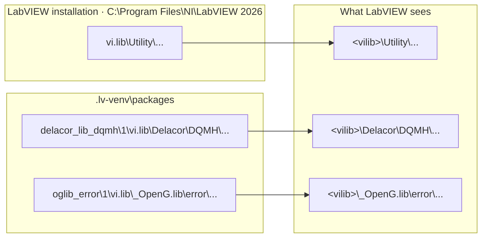
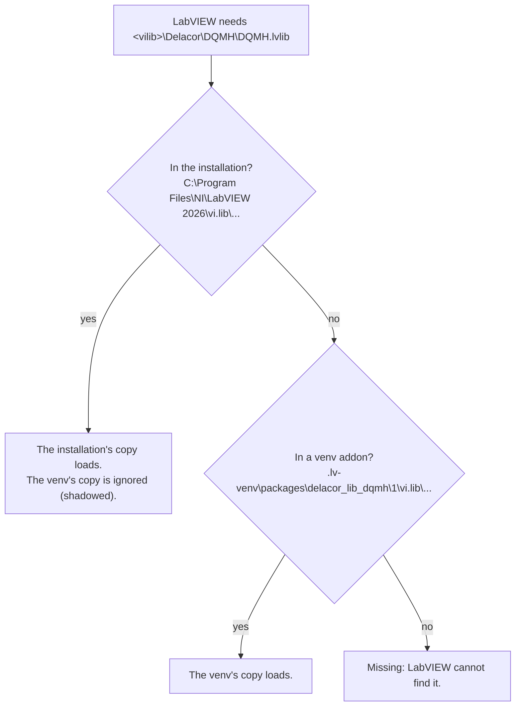

# Per-project dependencies (venvs)

A project can keep its packages to itself, the way a Python virtualenv or
`node_modules` does, instead of sharing one `vi.lib` with every other project
on the machine.

```console
$ cd C:\Git\MyProject
$ lvpm venv create --labview-version 2026
created C:\Git\MyProject\.lv-venv
  bound to       LabVIEW 2026 (64-bit)  v26.3
  VI Server port 3735

$ lvpm install                    # everything lvpm.toml lists, into .lv-venv
$ lvpm install oglib_error        # one more package, into .lv-venv and lvpm.toml
$ lvpm launch MyProject.lvproj    # a LabVIEW that sees the venv
```

On a venv, `lvpm install <name>` also writes the package into `lvpm.toml`:
the version given with `name@version`, else the one installed. An entry
that exists is updated in place, in its group; `--group dev` saves into
`[dependencies.dev]` instead. `lvpm uninstall <name>` takes the package out
of every group declaring it. Comments and formatting elsewhere in the file
stay as written. `--no-save` leaves the manifest alone for either command,
and `uninstall --all` never edits it.

- `lvpm venv create` makes `.lv-venv/` beside `lvpm.toml` by default and binds it to a
  LabVIEW version: `--labview-version`, else the manifest's `labview`.
  Binding to a newer IDE than the manifest's minimum is fine; an older one is
  refused. The venv directory ignores itself in git; the manifest is what you
  commit. `lvpm venv status` shows the binding, `lvpm venv remove` deletes
  the venv and everything in it.
- No activation step. Like cargo or npm, any `lvpm` command run at or below a
  directory holding a venv uses that venv. `--project <DIR>` names one from
  outside; `--global` says the installation itself is meant. An `lvpm.toml`
  with no venv beside it is an error, never a silent global install, except
  on a headless machine (see [ci-container.md](ci-container.md)).
  Every venv-mode command prints which venv it resolved to.

The manifest's format is in [manifest.md](manifest.md).

## Launching LabVIEW

`lvpm launch [<lvproj>]` starts a LabVIEW on the venv: an ini of the
venv's own (`.lv-venv/labview.ini`, copied from the target's `LabVIEW.ini` by
`lvpm venv create` without its recent-files lists, so the venv IDE never
offers projects from outside the venv; options you set in the venv IDE
persist; delete it to inherit your global settings again at the next launch)
with the venv mounted, VI Server on a port of its own, and its own
compiled-object cache, `LabVIEW Data` folder and temp directory under
`.lv-venv/`, handed over with `-pref`. Your primary LabVIEW, if open, is
untouched, and its autosave files, cache and log (`LabVIEW_*_cur.txt`) are
never shared with the venv's — look for the venv's log in `.lv-venv/temp`.
The venv starts with an empty `LabVIEW Data`, so personal customisations kept
there (icon templates, right-click plugins) are not available in it.

Before starting, `launch` checks the venv's install records against the
manifest's `[dependencies]` (`main` only): every package installed at a
version the manifest allows, all of its recorded files present, the relink
pass done where `relink = true`, and PostInstall run where the hook policy
runs it. It refuses on a mismatch and names each one; `--no-check` starts
anyway. Files edited or resaved since install are not detected.

`lvpm venv shortcut [<lvproj>]` writes a Windows shortcut,
`<project> (LabVIEW <year> <bits>-bit).lnk`, that runs
`lvpm --project <repo> launch [<lvproj>]` with LabVIEW's icon. The shortcut
goes in the project folder by default. `--desktop` puts it on the desktop,
and `--out PATH` takes a `.lnk` path or a folder. The shortcut runs `lvpm`,
not `LabVIEW.exe`, because a shortcut cannot set the venv's temp directory and
would skip the check above. When a launch from the shortcut fails, its console
stays open until you press Enter. The shortcut records the full path of the
`lvpm.exe` that wrote it, so recreate it if you move lvpm.

### The venv's name in window titles

On Windows, `launch` also starts a small hidden `lvpm` beside the venv
LabVIEW that keeps the project folder's name in its window titles, so a venv
IDE and your primary one (or two venvs) can be told apart in the taskbar and
in Alt+Tab:

```text
MyProject.lvproj - Project Explorer [MyProject]
Main.vi Front Panel on MyProject.lvproj/My Computer [MyProject] *
```

It tags the Getting Started window, Project Explorer, front panels, block
diagrams and class or library windows; dialogs and palettes keep their
titles. LabVIEW rewrites a title on every edit and save, and the watcher puts
the tag back straight after, so it can be missing for a moment. LabVIEW's
`*` for unsaved changes stays where LabVIEW shows it. The watcher reacts to
window events only, uses no CPU in between, and exits with its LabVIEW; each
launched venv LabVIEW has its own.

The `venv.title` [setting](configuration.md#settings) moves the name to the
front (`start`) or turns this off (`off`) — for instance for a tool that finds
LabVIEW's windows by their exact title. A LabVIEW on the venv started some
other way than `lvpm launch` is not tagged.

### The venv's icon and taskbar button

The same watcher gives the venv LabVIEW's windows an icon and a taskbar
button of their own. The icon is the bound LabVIEW's icon with a coloured disc
in the upper right. The colour comes from the project folder's name, so two
venvs differ and each keeps its colour. lvpm writes it to `.lv-venv\venv.ico` at each launch and for
`venv shortcut`. It shows in the title bars, on the taskbar and in Alt+Tab.

LabVIEW groups all its windows under one taskbar button per LabVIEW
version. The watcher gives each venv's windows an app id of their own
(`lvpm.venv.<hash of the project path>`), so a venv's LabVIEW gets its own
button, separate from your normal LabVIEW and from other venvs. Right-click
that button and choose *Pin to taskbar*: the pin shows the venv's icon and
name, and clicking it runs `lvpm --project <repo> launch`. The pin records the
full path of the `lvpm.exe` that launched the venv, so pin it again if you
move lvpm.

The properties lvpm sets on LabVIEW's windows go away when that LabVIEW
exits.

## Layout

```text
.lv-venv/
  packages/<pkg>/1/    package addon and its mirrored LabVIEW tree
  installed/           package installation records
  venv.json            LabVIEW binding
  labview.ini          venv-specific LabVIEW settings
  objcache/ data/ temp/  isolated LabVIEW runtime files
```

The venv's log lives in lvpm's global log folder, not in the venv; see
[configuration.md](configuration.md#logs).

## How it works

The `packages/` directory is an [LVAddons](https://labviewwiki.org/wiki/LVAddons)
location, one addon per package, each mirroring the LabVIEW install dir
under `<pkg>/1/`. A LabVIEW started with `LVAddons.AdditionalLocations`
pointing there overlays them onto its own tree, so a package in the venv
resolves as `<vilib>/...` exactly as a globally installed one would. The VIs
you write against it link portably, and `C:\Program Files` never changes.
Needs LabVIEW 2024 Q1 or later.



The overlay only adds files; it never replaces one. For each path LabVIEW
looks in its own installation first and in the venv's addons second:



So a package that is also in the installation, from VIPM or an earlier
global install, loads from there whatever version the venv holds. See
below for the warning lvpm gives.

Environments created with the old layout must be recreated: close their
LabVIEW instance, then run `lvpm venv remove`, `lvpm venv create`, and
`lvpm install`. Removing the venv also removes its installed packages and
venv-specific settings.

Two things follow from LabVIEW reading an addon's contents at launch:

- After `lvpm install`, a LabVIEW already open on the venv cannot see the new
  files. Restart it with `lvpm launch`. For the same reason the relink runs
  in a LabVIEW that lvpm starts fresh on the venv, and is refused while one
  is already open there.
- The real installation always wins over the overlay: a package installed
  both globally and in the venv loads from the global copy, whatever its
  version. Keep the target installation clean of what the venv provides
  (see [below](#keeping-the-labview-installation-clean)).
  lvpm warns when it is not: after an install into the venv, at `lvpm launch`
  and in `lvpm venv status`, it names every venv package whose LabVIEW files
  the installation has too (from VIPM, `lvpm install --global` or a copy by
  hand) and how to remove that copy. The check takes milliseconds.

## Keeping the LabVIEW installation clean

A venv adds to the LabVIEW installation; it does not hide it. Everything in
the installation's `vi.lib` is still there when LabVIEW runs on a venv, and
that causes two problems:

- **Shadowing.** A package in both places loads from the LabVIEW vi.lib installation, as
  described above.
- **Undeclared dependencies.** A project VI can link to a library that is
  installed in LabVIEW but not listed in `lvpm.toml`. It loads on that
  machine and breaks on a colleague's or in CI, where only what the manifest
  lists is installed. lvpm cannot catch this: `lvpm launch` checks the venv
  against the manifest, not against what the project's VIs use.

So the LabVIEW installation should hold as few packages as possible:

- **Libraries your code calls** (frameworks, OpenG, toolkits, anything a
  project VI links to) go in each project's venv, not in LabVIEW.
- **Editor tools you use in every project** (Quick Drop plugins, menu
  add-ons, G-CLI) can stay in the installation, as long as no project VI
  calls into them.

To move an existing machine over, uninstall the libraries from LabVIEW (with
VIPM, or `lvpm uninstall --global <pkg>` for ones lvpm installed), then run
`lvpm install` in each project. `lvpm venv status` lists any venv package the
installation still has a copy of.
